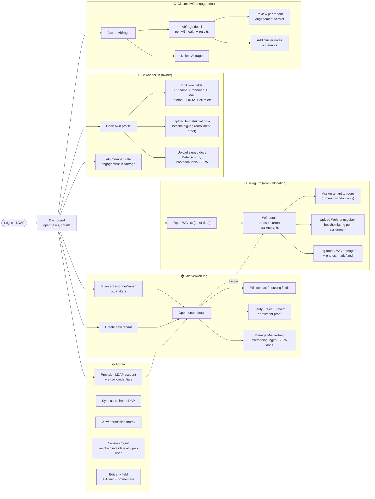

# CArtei — User Workflow Graph

Functionality organized by **who does the work**, end to end. Roles come from LDAP
groups (`tenant_access.py`): `owner` (tenant on own record), `helper`, `mietverwaltung`
(MV), `belegium`, `cluster`, `admin`. Everyone logs in via LDAP first.

## Workflow detail

### 👤 Bewohner\*in (own record)
1. **See & edit own profile** — Rufname, Pronomen, contact, FLINTA, Soli-Miete-Wunsch, mailbox opt-in. Sensitive fields (name, DOB) are view-only or MV-editable.
2. **Enrollment proof** — upload Immatrikulationsbescheinigung; MV/admin verifies. (`cartei_vision` will auto-verify Uni-HD signatures.)
3. **Personal documents** — upload signed Datenschutz, Photoerlaubnis, SEPA-Lastschriftmandat.
4. **AG engagement** — as an AG member, rate fellow tenants' engagement inside an open Abfrage (`ag_edit`).

### 🏠 Mietverwaltung
Full tenant lifecycle: create → edit contact/housing → verify enrollment proofs → manage rental docs (Mietvertrag, Mietbedingungen, SEPA). Sees most tenant fields; edits contract-relevant ones.

### 🗝️ Belegium
Room allocation only, and only inside the **move-in window** (future move-ins + first two weeks): assign tenants to rooms via WG detail, upload Wohnungsgeberbescheinigung per assignment, log/fix room & WG damages with photos.

### 📋 Cluster
Run AG engagement cycles: create an Abfrage, review per-AG health and per-tenant verdicts, keep cluster notes. `AGAbfrage.state` (open/grace/closed) is computed from dates.

### ⚙️ Admin
Superset of all views/edits + operational tasks: provision LDAP accounts (emails credentials), sync users from LDAP, inspect the permission matrix, manage/revoke sessions, and edit any field including Admin-Kommentare.

## Cross-cutting
- **Internal notes** — most roles can add notes scoped by `NoteSourceGroup`; used across tenant/assignment views.
- **Documents hub** (`/documents/`) — one place to see every document type and its status.
- **Auditing** — mutations snapshot into `entity_history` (JSONB) via the `Historized` base; actor from request-boundary contextvars.
